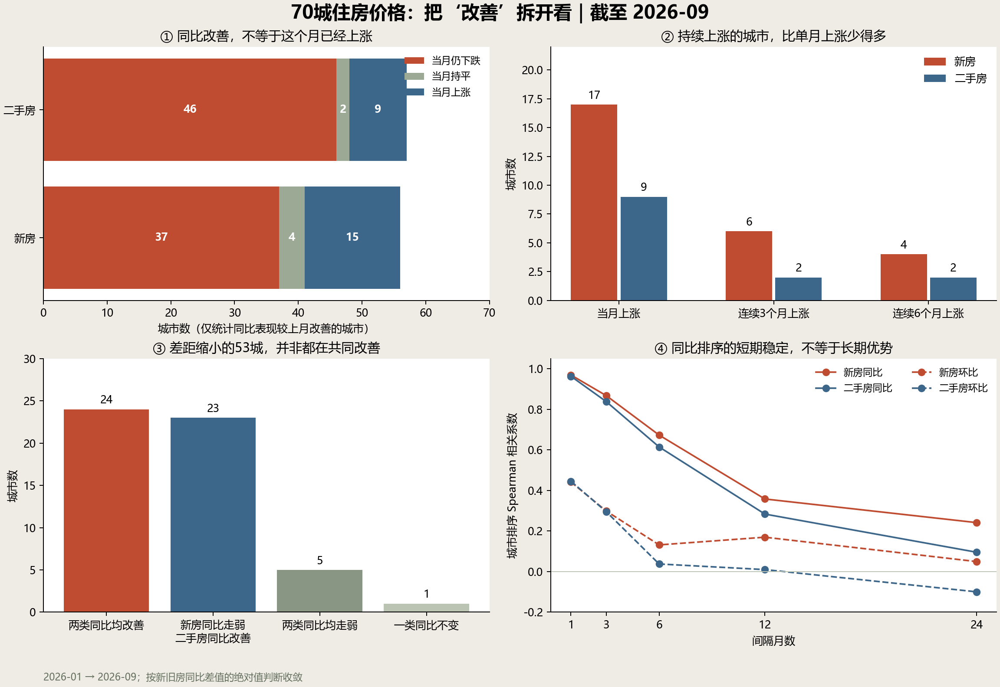

# 70城住房价格变化进一步分析

本次分析把“同比改善”“单月上涨”“连续上涨”和“新旧房收敛”分别计算。数据范围为 2024 年 1 月至 2026 年 9 月，共 33 个月、70 城、两类住宅。结论描述价格指数的结构和持续性，不解释政策效果，也不预测未来房价。



## 同比改善和当月上涨经常不是同一件事

2026 年 9 月，57 城二手房同比表现较 8 月改善，其中 46 城在 9 月仍环比下跌，约占改善组的 80.7%。对应的新房改善组为 56 城，其中 37 城仍环比下跌。这里的“改善”严格指同比涨跌幅数值提高，并不是同比已经为正。

这意味着，年度比较表现的改善，不能作为“当月止跌”的充分证据。按连续性看，2026 年 7—9 月有 57 城二手房每个月都环比下跌；最近六个月每个月都环比下跌的也有 50 城。

同比比较窗口向前移动时，会同时受到本月变化和去年同月基数的影响。例如西安二手房 2026 年 9 月同比从上月的 −6.0% 变为 −5.1%，但当月仍环比下降 0.3%，去年同月则环比下降 1.2%。年度降幅收窄与当月继续下跌可以同时发生。这里未把同比改善全部归因于基数，也未估计所谓“基数贡献占比”。

## 持续上涨比单月上涨稀少且更集中

| 截至2026年9月的条件 | 新房城市数 | 二手房城市数 |
| --- | ---: | ---: |
| 最新月环比上涨 | 17 | 9 |
| 最近三个月每个月均环比上涨 | 6 | 2 |
| 最近六个月每个月均环比上涨 | 4 | 2 |
| 最近六个月每个月均未环比下跌 含持平 | 8 | 4 |

新房连续六个月环比上涨的城市为上海、杭州、广州和深圳；二手房为上海、深圳。若把官方指数持平也纳入“未再下跌”，二手房名单增加广州、沈阳。

因此，少数城市的上涨不能直接推广为普遍恢复，单月上涨名单也不能替代持续性名单。这个结果对定义敏感：严格上涨与“上涨或持平”应同时展示。所有判断依据官方保留一位小数的指数；100.0 被当作发布口径下的持平，不推测被舍入的微小变化。

## 历史上的单月负转正，多数很快再次转负

把一次“转正事件”定义为某城某类住宅上个月环比小于零、这个月大于零。只使用还能观察到后续两个月的事件，因此事件窗口为 2024 年 2 月至 2026 年 7 月。8、9 月的事件不能据此判定后续成功或失败。

| 转正事件的后续表现 | 新房 | 二手房 |
| --- | ---: | ---: |
| 可完整观察的事件数 | 134 | 55 |
| 从转正当月起连续三个月严格上涨 | 27 | 11 |
| 随后两个月均没有再次下跌 含持平 | 36 | 13 |
| 随后两个月至少一次重新下跌 | 98 | 42 |

二手房的 55 次事件中，42 次在后续两个月至少一次重新下跌，占 76.4%。新房对应为 98/134，约 73.1%。因此样本内的单月负转正，通常不足以确认持续的价格改善。

事件不是独立样本：同一城市可以反复转正，多座城市也可能在同一月份一起变化。上述比例是本样本的事件描述，不是未来某城的下跌概率，不使用二项分布显著性检验或把事件数当成人数。

## 差距缩小可以对应三种很不一样的路径

采用新房与二手房同比差值的绝对值衡量距离，比较 2026 年 1 月与 9 月。53 城的绝对差距缩小，3 城不变，14 城扩大。在这 53 城内：

| 差距缩小的路径 | 城市数 | 含义 |
| --- | ---: | --- |
| 两类同比均改善 | 24 | 两类变化都向更高值移动 但不一定均已上涨 |
| 新房同比走弱 二手房同比改善 | 23 | 两端向中间靠近 |
| 两类同比均走弱 | 5 | 新房变弱得更快 距离也可能缩小 |
| 一类同比不变 | 1 | 由另一类变化实现收敛 |

所以，53 个收敛城市中，只有 24 个同时出现两类同比改善。新旧房看起来更同步，不应直接解释为两类市场共同恢复。

例如上海的同比差值由 11.0 缩至 2.0 个百分点：二手房同比提高 7.6 个百分点，新房同比涨幅回落 1.4 个百分点，两者共同形成 9.0 个百分点的收敛。这是差值的算术分解，不是经济原因分解；新房涨幅回落也不等于新房当月价格下跌。

计算严格区分有符号差值与绝对距离。例如西宁有符号差值下降，但绝对差距扩大，不能计入上述 53 城。使用一位小数对应的整数计算，避免浮点误差把“不变”误计为“缩小”。

## 同比排名的短期稳定 不等于城市长期优势

对每种住宅类型，计算不同间隔月份之间 70 城涨跌幅排名的 Spearman 相关；同值采用平均秩，再对全部可用月份对取平均。

| 指标 | 间隔1个月 | 间隔6个月 | 间隔12个月 |
| --- | ---: | ---: | ---: |
| 新房同比排序 | 0.969 | 0.673 | 0.358 |
| 二手房同比排序 | 0.963 | 0.615 | 0.284 |
| 新房环比排序 | 0.442 | 0.132 | 0.170 |
| 二手房环比排序 | 0.445 | 0.038 | 0.010 |

相邻月份的同比排序高度相似，但一年间隔下明显减弱；环比排序的持续性更低。同比序列共享大量年度比较窗口信息，这种平滑也会影响排序稳定性。因此不能仅凭相邻两个月同比排名相近，就认定城市具有稳定、长期的优势。

上述是全体可用月份对的描述，不是只挑起止两个时点；但月份对互相重叠，也不是独立重复试验，不报告把它们当独立观测的置信区间。相关系数描述排序关联，不是因果或预测效果。

## 数据与方法边界

数据来自项目保存的国家统计局逐月官方表格，链接见 `../data/sources.json`。2026 年开始使用 2025 年作为新一轮对比基期并调整权数，本分析不跨基期拼接定基指数，不推算绝对房价，也不把月度涨跌幅相加。

脚本额外记录同比与环比变化恒等关系的可比性诊断。2025 年相应比值的最大残差约为 0.18 个百分点，2026 年少数记录偏离更大。不同发布年度的基期、权数及一位小数舍入限制了精确恒等关系的使用，因此没有用这些比值强行计算“基数贡献百分比”，也没有把残差直接判为原表错误。原始记录及最大的残差明细保存在结果 JSON 中，供进一步核对。

价格指数可以检验变化方向、持续性、分化路径和相对排名。要回答为什么某城改善，还需要另外收集成交量、库存等证据；单靠价格序列无法区分需求恢复、供给变化等机制。

## 复现与结果文件

```powershell
python scripts/analyze_dynamics.py
# 可选 科学图形需要 matplotlib
python -m pip install 'matplotlib>=3.8,<4'
python scripts/analyze_dynamics.py --figures
```

- `scripts/analyze_dynamics.py`：计算脚本，统计部分仅使用 Python 标准库。
- `analysis/dynamics.json`：逐月分类、城市名单、转正事件、收敛分解、全部排序相关、可比性诊断及输入数据 SHA-256。
- `analysis/dynamics.png`、`analysis/dynamics.svg`：四面板分析图。

主要分类已接入正式网页的“发现”窗口，可点击城市回到图中追踪；此记录保留完整方法、结果与边界。
